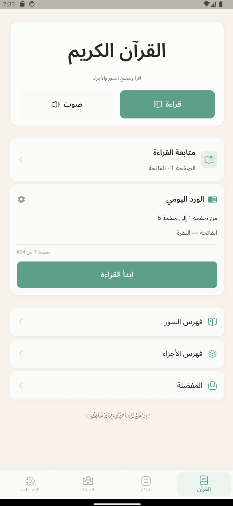
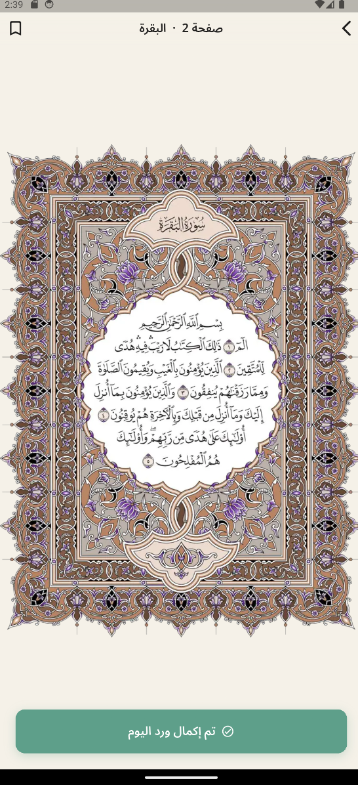
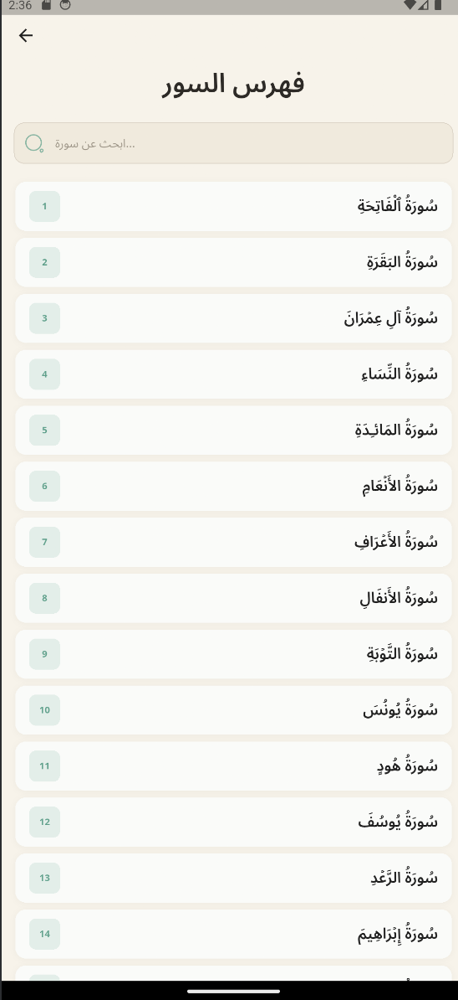
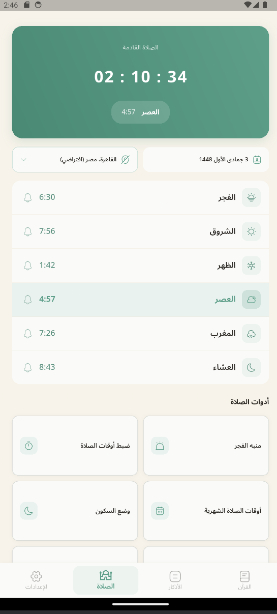
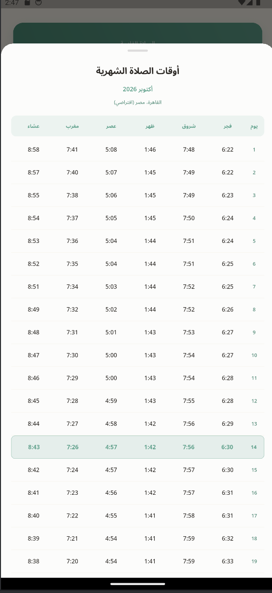
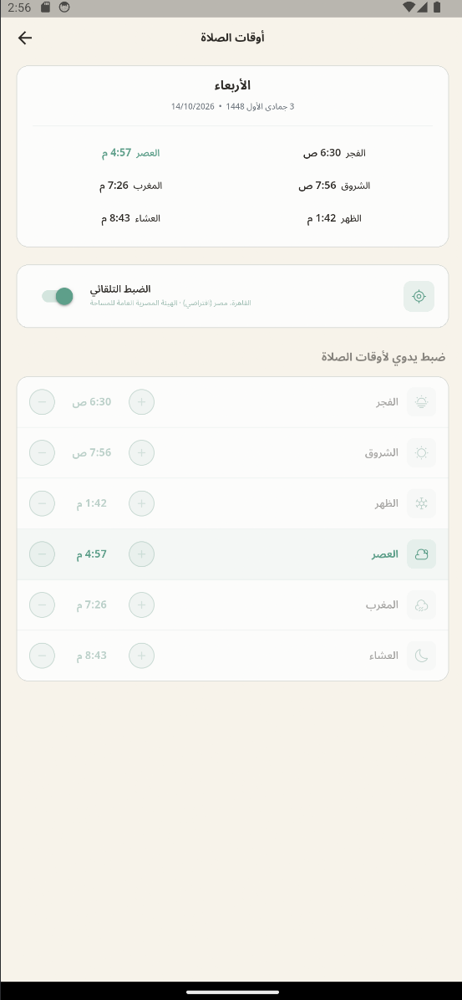
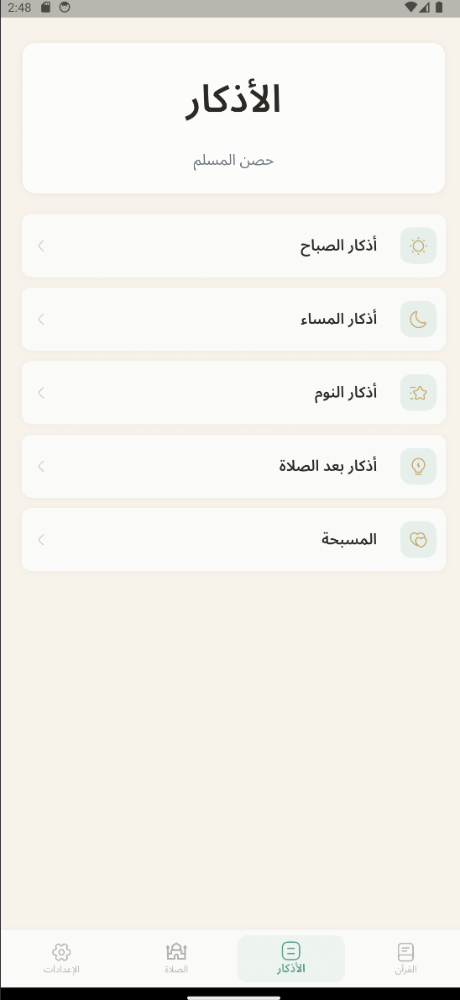
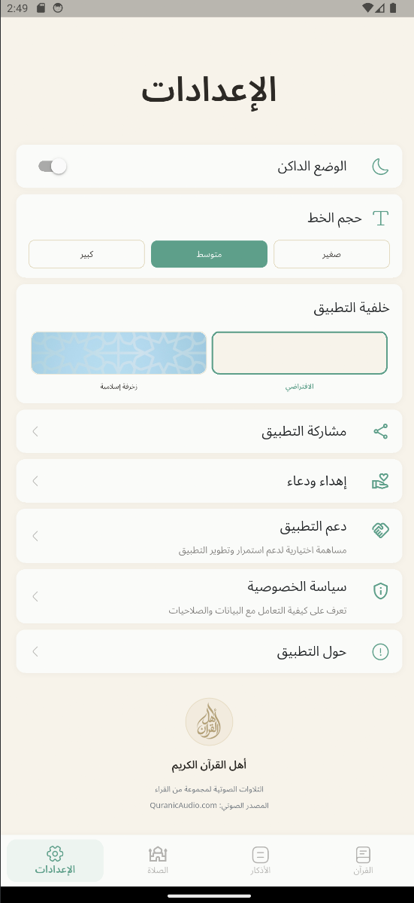
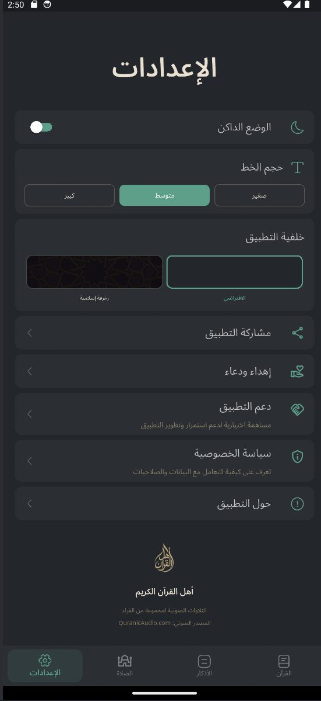

# ahl-al-quran-flutter-showcase
# Ahl Al-Quran Al-Kareem

A modern Flutter-based Quran, Azkar, and Prayer Times application built for Android.

> This repository is a public showcase only.  
> The production source code is private.

## About the App

Ahl Al-Quran Al-Kareem is an Islamic mobile application focused on Quran reading, daily Azkar, prayer times, and personal worship tracking.

The app is designed to provide a clean Arabic-first experience with offline Quran pages, prayer notifications, customizable themes, and a polished mobile UI.

## Main Features

- Full Quran Mushaf with 604 pages
- Browse by Surah and Juz
- Quran bookmarks
- Last-read page tracking
- Daily Wird / reading plan
- Azkar categories
- Tasbeeh counter
- Prayer times based on location
- Monthly prayer schedule
- Manual prayer-time adjustment
- Adhan and prayer notifications
- Light Mode and Dark Mode
- Islamic background theme
- Background-aware UI surfaces
- App sharing
- App support via external PayPal link
- Privacy Policy integration
- Offline Quran page access

## Screenshots

### Quran

| Quran Home | Mushaf | Surah Index |
|---|---|---|
|  |  |  |

### Prayer

| Prayer Times | Monthly Prayer Times | Prayer Settings |
|---|---|---|
|  |  |  |

### Azkar & Settings

| Azkar | Settings | Dark Mode |
|---|---|---|
|  |  |  |

## Tech Stack

- Flutter
- Dart
- BLoC
- Provider
- GetIt
- Hive
- Dio
- just_audio
- flutter_local_notifications
- geolocator
- geocoding
- flutter_map
- OpenStreetMap
- url_launcher
- share_plus

## Architecture

The application uses a hybrid Flutter architecture:

- BLoC for data-heavy features
- Provider / ChangeNotifier for local application preferences
- GetIt for dependency injection
- Repository pattern for Quran data access
- Hive for persistent local storage

The Quran module keeps page-based navigation independent from bookmarks, Wird, and Surah/Juz navigation.

## Performance & Optimization

One of the major optimization tasks was reducing the application size while preserving Quran readability.

The original Mushaf image set contained 604 high-quality JPG/PNG pages.

The pages were converted to optimized WebP assets, reducing the Mushaf asset size by approximately 49%.

Release APK size was reduced from approximately:

244 MB

to:

154 MB

while preserving normal Quran reading quality.

## Android & Google Play Readiness

- Android API 36 target
- Android 16 compatible
- Release signing configured
- Android App Bundle ready
- Google Play Privacy Policy integrated
- Exact alarm permission handling for prayer notifications
- Location permission handling for prayer-time calculation
- No advertising SDKs
- No user accounts
- No analytics or tracking SDKs

## Privacy

Privacy Policy:

https://eyad5.github.io/ahl-al-quran-privacy/

The app does not use advertising or analytics SDKs and does not maintain a developer-operated user database.

Location is used primarily for prayer-time calculation and related location features.

## Development Highlights

Some key challenges solved during development:

- Building a full 604-page offline Mushaf experience
- Smooth page navigation with zoom support
- Preserving Quran page quality while reducing application size
- Location-based prayer calculations
- Exact prayer notification scheduling
- Android system inset and SafeArea handling
- Light/Dark background-aware UI system
- First-run onboarding optimization
- Android 16 / API 36 compatibility
- Google Play release preparation

## Project Status

The application is currently being prepared for its first Google Play release.

## Screenshots Folder

Recommended repository structure:

```text
ahl-al-quran-showcase/
│
├── README.md
│
└── screenshots/
    ├── onboarding.png
    ├── quran-home.png
    ├── mushaf.png
    ├── surah-index.png
    ├── azkar.png
    ├── prayer.png
    ├── monthly-prayer.png
    ├── prayer-settings.png
    ├── settings-light.png
    └── settings-dark.png
